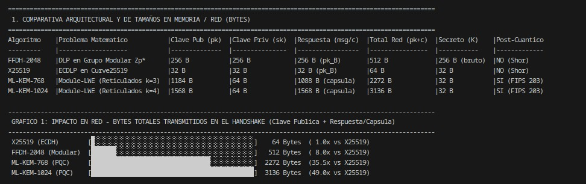
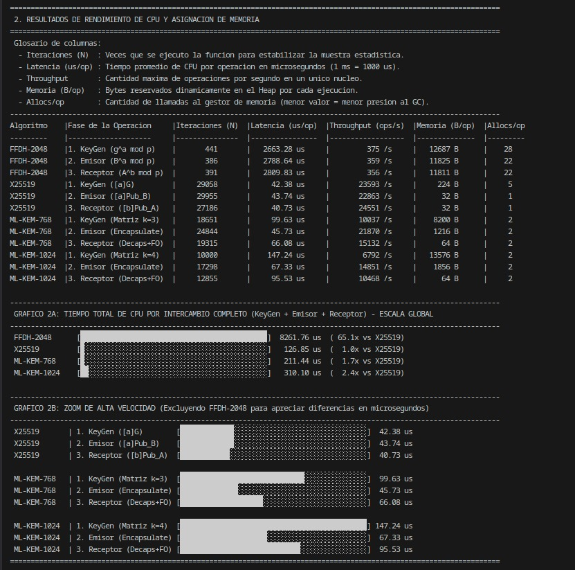
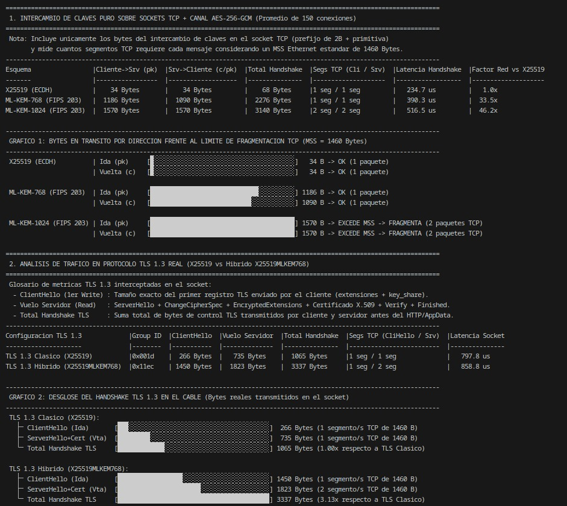

# Evaluación Empírica de Criptografía Post-Cuántica: ML-KEM (FIPS 203) vs. Esquemas Clásicos

Banco de pruebas (benchmarking) desarrollado en Go para evaluar el rendimiento computacional (CPU y memoria) y el impacto en la capa de transporte de red (TCP y TLS 1.3) del estándar post-cuántico **ML-KEM** frente a los algoritmos clásicos de intercambio de claves **Diffie-Hellman sobre cuerpos finitos (FFDH-2048)** y **Curvas Elípticas (ECDH X25519)**.

---

## 1. Requisitos y Configuración del Entorno

El proyecto utiliza exclusivamente la biblioteca estándar de Go (`crypto/mlkem`, `crypto/ecdh`, `crypto/tls`, `math/big`), sin dependencias externas ni compilación cruzada en C (CGO).

* **Requisito excluyente:** Go 1.24 o superior (versión en la que se estandarizó `crypto/mlkem` bajo FIPS 203 y el soporte nativo para `X25519MLKEM768` en TLS 1.3).

Verificar versión instalada:
```bash
go version
```

Estructura de archivos del proyecto:
```text
ml-kem-test/
├── go.mod          # Definición del módulo Go
├── bench_test.go   # Microbenchmarks de CPU, memoria y tamaño de primitivas
├── net_test.go     # Pruebas de impacto en red sobre sockets TCP reales y TLS 1.3
└── README.md       # Documentación técnica
```

---

## 2. Instrucciones de Ejecución

### A. Ejecutar el reporte comparativo de CPU y Memoria (`bench_test.go`)
Evalúa tamaños de claves/cápsulas y mide tiempos de ejecución por fase algorítmica:
```bash
go test -v -run TestReporteComparativo
```

### B. Ejecutar el reporte de impacto en Red y TLS 1.3 (`net_test.go`)
Levanta servidores y clientes locales sobre sockets TCP instrumentados para medir bytes transmitidos en el cable y fragmentación de segmentos:
```bash
go test -v -run TestReporteRed
```

### C. Ejecutar la suite completa (CPU + Red)
```bash
go test -v -run "TestReporte"
```

### D. Ejecutar los microbenchmarks nativos de Go (salida estándar sin gráficos)
```bash
go test -bench=. -benchmem
```

---

## 3. Arquitectura de las Pruebas y Qué Hace Cada Módulo

### Módulo 1: Análisis de Primitivas y Rendimiento de CPU (`bench_test.go`)

Aísla las operaciones matemáticas de cuatro algoritmos que representan tres paradigmas criptográficos distintos:

1. **FFDH-2048 (RFC 3526 - Grupo MODP 14):** Diffie-Hellman clásico basado en exponenciación modular ($g^a \bmod p$) con un primo seguro de 2048 bits. Su seguridad depende del Problema del Logaritmo Discreto (DLP) sobre grupos multiplicativos $\mathbb{Z}_p^*$. Vulnerable al algoritmo cuántico de Shor.
2. **X25519 (RFC 7748):** Diffie-Hellman sobre la curva elíptica de Montgomery Curve25519 en el cuerpo primo $\mathbb{F}_{2^{255}-19}$. Su seguridad depende del Logaritmo Discreto en Curvas Elípticas (ECDLP). Provee 128 bits de seguridad clásica. Vulnerable al algoritmo cuántico de Shor.
3. **ML-KEM-768 (NIST FIPS 203 - Categoría de Seguridad 3):** Mecanismo de encapsulamiento de claves basado en el problema *Module Learning With Errors* (M-LWE) sobre reticulados algebraicos (*lattices*). Opera con matrices de dimensión $k = 3 \times 3$ sobre el anillo cociente de polinomios $R_q = \mathbb{Z}_{3329}[X]/(X^{256}+1)$. Seguridad equivalente o superior a AES-192 frente a adversarios clásicos y cuánticos.
4. **ML-KEM-1024 (NIST FIPS 203 - Categoría de Seguridad 5):** Mismo anillo polinomial que ML-KEM-768, incrementando la dimensión de la matriz pública a $k = 4 \times 4$ y reduciendo la compresión con pérdida de los coeficientes. Seguridad equivalente o superior a AES-256.

#### Equivalencia operativa de las fases evaluadas
Para comparar un acuerdo de claves interactivo (DH/ECDH) con un mecanismo de encapsulamiento unidireccional (KEM) en el contexto de un establecimiento de sesión efímero:
* **Fase 1 (`KeyGen`):** Generación del par de claves efímero $(pk, sk)$ por parte de quien inicia la negociación.
* **Fase 2 (`Emisor`):** En DH/ECDH corresponde al cálculo del secreto compartido por parte de un extremo ($B^a \bmod p$ o $[a]P_B$); en ML-KEM corresponde a la operación $\text{Encaps}(pk) \rightarrow (K, c)$, que genera la clave simétrica $K$ y el texto cifrado o cápsula $c$.
* **Fase 3 (`Receptor`):** En DH/ECDH corresponde al cálculo simétrico del otro extremo ($A^b \bmod p$ o $[b]P_A$); en ML-KEM corresponde a $\text{Decaps}(sk, c) \rightarrow K$.

---

### Módulo 2: Análisis de Tráfico en Capa de Transporte (`net_test.go`)

Instrumenta la interfaz `net.Conn` de la biblioteca estándar mediante un interceptor (`meteredConn`) que contabiliza con precisión de bytes todas las lecturas y escrituras sobre el descriptor de archivo del socket TCP antes de llegar al buffer de aplicación.

Ejecuta dos experimentos sobre `127.0.0.1` (promediando 150 conexiones completas por esquema):

1. **Experimento A - Canal TCP Puro + AES-256-GCM:**
   * Evalúa el intercambio de claves sin cabeceras de protocolos superiores (únicamente 2 bytes de prefijo de longitud + bytes crudos de la primitiva).
   * Una vez derivada la clave compartida $K$ de 32 bytes, cifra y autentica un mensaje de prueba mediante **AES-256-GCM** para verificar la integridad de extremo a extremo.
   * Compara `X25519`, `ML-KEM-768` y `ML-KEM-1024`.

2. **Experimento B - Handshake TLS 1.3 Real (`crypto/tls`):**
   * Genera un certificado X.509 autofirmado con clave **ECDSA P-256** en memoria.
   * Compara una negociación **TLS 1.3 Clásica (`X25519`, Group ID `0x001d`)** contra una negociación **TLS 1.3 Híbrida Post-Cuántica (`X25519MLKEM768`, Group ID `0x11ec`)**.
   * Mide el tamaño exacto del primer registro enviado por el cliente (`ClientHello`) y el vuelo completo de respuesta del servidor (`ServerHello` + `EncryptedExtensions` + `Certificate` + `CertificateVerify` + `Finished`).

---

## 4. Guía de Interpretación de Tablas y Gráficos

### Tablas y Gráficos de `bench_test.go`

* **Tabla 1 (Comparativa Arquitectural y de Tamaños):**
  Muestra la huella exacta en memoria de cada clave y la columna `Total Red (pk+c)`, que representa el mínimo teórico de bytes que deben cruzar el canal para acordar un secreto de 256 bits (32 bytes):
  * `X25519`: $32\text{ B} + 32\text{ B} = 64\text{ Bytes}$.
  * `FFDH-2048`: $256\text{ B} + 256\text{ B} = 512\text{ Bytes}$.
  * `ML-KEM-768`: $1.184\text{ B } (pk) + 1.088\text{ B } (c) = 2.272\text{ Bytes}$.
  * `ML-KEM-1024`: $1.568\text{ B } (pk) + 1.568\text{ B } (c) = 3.136\text{ Bytes}$.

* **Gráfico 1 (Impacto en Red - Bytes Totales):**
  Visualiza la proporción de volumen de datos respecto a X25519. Demuestra que ML-KEM-768 multiplica por **35.5x** el volumen de datos criptográficos del intercambio, mientras que ML-KEM-1024 lo multiplica por **49.0x**.

 
*Figura 1: ejemplo de benchmark sobre una PC con Ryzen 3 2200g y 24GB de RAM DDR4*

* **Tabla 2 (Rendimiento de CPU y Memoria):**
  * `Iteraciones (N)`: Muestra estadística ejecutada por el motor de benchmark.
  * `Latencia (us/op)`: Tiempo de CPU por operación en microsegundos ($1\text{ ms} = 1.000\ \mu\text{s}$).
  * `Throughput (ops/s)`: Operaciones máximas por segundo en un único hilo de ejecución.
  * `Memoria (B/op)` y `Allocs/op`: Memoria dinámica reservada en el *heap* y cantidad de llamadas al alocador por operación.

* **Gráfico 2A (Tiempo Total de CPU - Escala Global):**
  Suma las tres fases (`KeyGen + Emisor + Receptor`). En esta escala, la barra de `FFDH-2048` ocupa el 100% del ancho (~1.500 a 3.000 $\mu$s), mientras que `X25519` y ambos `ML-KEM` quedan reducidos a un bloque mínimo por ser entre **40 y 80 veces más veloces**.

* **Gráfico 2B (Zoom de Alta Velocidad):**
  Elimina a `FFDH-2048` del eje para comparar mano a mano `X25519`, `ML-KEM-768` y `ML-KEM-1024`. Permite observar:
  1. Que las operaciones de reticulados se ejecutan en decenas de microsegundos, en el mismo orden de magnitud que las curvas elípticas.
  2. Que en ML-KEM la fase `3. Receptor (Decaps+FO)` es sistemáticamente más costosa que `2. Emisor (Encapsulate)`. Esto refleja el costo computacional de la **Transformación Fujisaki-Okamoto (FO)**: para alcanzar seguridad contra ataques activos de texto cifrado escogido (**IND-CCA2**), el receptor debe re-ejecutar internamente el algoritmo de encapsulación sobre el mensaje descifrado y verificar que la cápsula generada coincida bit a bit con la recibida.



*Figura 2: ejemplo de benchmark sobre una PC con Ryzen 3 2200g y 24GB de RAM DDR4*

---

### Tablas y Gráficos de `net_test.go`

* **Cálculo de Segmentos TCP (MSS = 1.460 Bytes):**
  En redes Ethernet estándar, la unidad máxima de transmisión (MTU) es de **1.500 bytes**. Restando 20 bytes de la cabecera IPv4 y 20 bytes de la cabecera TCP básica, la carga útil máxima de un segmento TCP (**MSS - Maximum Segment Size**) es de **1.460 bytes**. Todo mensaje que supere ese umbral fuerza a la pila del sistema operativo a dividir el envío en múltiples paquetes físicos.

* **Gráfico 1 de Red (Primitivas Puras vs. Límite MSS):**
  Muestra que en un protocolo minimalista a medida, tanto la clave pública ($1.184\text{ B}$) como la cápsula ($1.088\text{ B}$) de **ML-KEM-768** entran en un único segmento TCP por dirección. En cambio, **ML-KEM-1024** ($1.568\text{ B}$) supera el límite de 1.460 bytes tanto a la ida como a la vuelta, forzando **2 segmentos TCP** en cada sentido incluso sin cabeceras TLS.

* **Gráfico 2 de Red (Desglose del Handshake TLS 1.3):**
  Evidencia qué ocurre en un protocolo de producción real cuando a las primitivas criptográficas se les suman las estructuras de control TLS:
  * **En TLS 1.3 Clásico (`X25519`):** El `ClientHello` mide **~290 bytes** (1 segmento TCP) y la respuesta del servidor con el certificado X.509 mide **~750 bytes** (1 segmento TCP).
  * **En TLS 1.3 Híbrido (`X25519MLKEM768`):** La extensión `key_share` transporta concatenadas las claves públicas de X25519 ($32\text{ B}$) y ML-KEM-768 ($1.184\text{ B}$). Sumado a las cabeceras y extensiones TLS, el `ClientHello` asciende a **~1.474 bytes**, cruzando el umbral de 1.460 bytes del MSS y dividiéndose en **2 segmentos TCP**. Del mismo modo, el vuelo del servidor incorpora la cápsula híbrida ($1.120\text{ B}$) más el certificado, ascendiendo a **~1.840 bytes** y dividiéndose también en **2 segmentos TCP**.


*Figura 3: ejemplo de benchmark de red sobre una PC con Ryzen 3 2200g y 24GB de RAM DDR4*

---

## 5. Implicancias de Ingeniería y Conclusiones Técnicas

Los resultados experimentales permiten extraer cuatro conclusiones fundamentales para la arquitectura de sistemas y redes:

### 1. El rendimiento de CPU no es un obstáculo para ML-KEM
Existe el preconcepto de que la criptografía post-cuántica es computacionalmente pesada. Los benchmarks demuestran lo contrario:
* **FFDH-2048** es lento porque el algoritmo de ataque clásico (*General Number Field Sieve*) obliga a trabajar con enteros de 2048 bits (32 palabras de 64 bits), requiriendo aritmética de precisión múltiple por software para la exponenciación modular.
* **ML-KEM** trabaja sobre el anillo $\mathbb{Z}_{3329}[X]/(X^{256}+1)$. Como el módulo primo es $q = 3329$, todos los coeficientes polinomiales caben en enteros nativos de 16 bits (`int16`). Además, dado que $3329 \equiv 1 \pmod{512}$, el anillo admite raíces primitivas de la unidad, permitiendo multiplicar polinomios mediante la **Transformada Teórica de Números (NTT)** en complejidad cuasi-lineal $O(n \log n)$ en lugar de cuadrática $O(n^2)$.

### 2. El cuello de botella se traslada de la CPU a la Capa de Transporte
El costo real de adoptar ML-KEM radica en la amplificación de ancho de banda durante el establecimiento de sesión (*Wire Overhead*). En TLS 1.3, pasar de `X25519` a `X25519MLKEM768` más que triplica el tamaño total del handshake (de ~1.1 KB a ~3.4 KB) y duplica la cantidad de segmentos TCP requeridos tanto para el `ClientHello` como para la respuesta del servidor.

### 3. Impacto de la segmentación TCP en enlaces con pérdida de paquetes
En una red local sin pérdidas (`loopback`), enviar 1 o 2 segmentos TCP añade menos de 50 microsegundos de diferencia. Sin embargo, en redes WAN, enlaces móviles o satelitales con pérdida de paquetes (*packet loss* $\ge 1\%$):
* Para que el servidor pueda procesar el `ClientHello`, necesita recibir **ambos segmentos TCP**.
* Si se pierde uno solo de los dos segmentos, se produce bloqueo de cabecera (*Head-of-Line Blocking*): el handshake queda detenido hasta que expira el temporizador de retransmisión TCP (*RTO - Retransmission Timeout*), degradando severamente la latencia de cola (*tail latency*, percentil